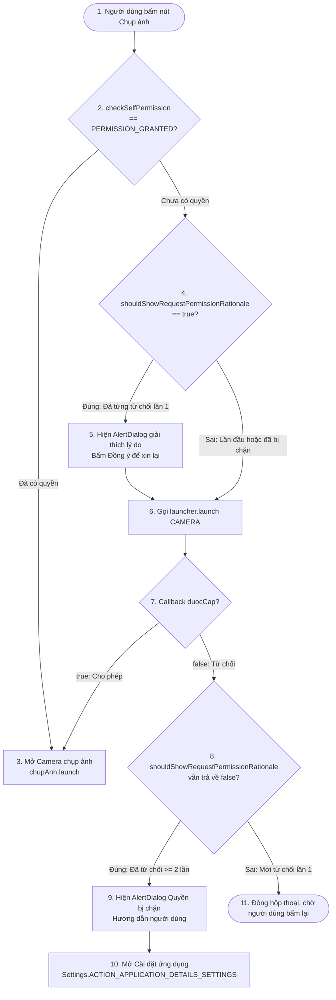

# INT4211 - LẬP TRÌNH TRÊN CÁC THIẾT BỊ DI ĐỘNG
## BÁO CÁO THỰC HÀNH LAB A7: XIN QUYỀN TRUY CẬP TÀI NGUYÊN (RUNTIME PERMISSION)

---

### THÔNG TIN SINH VIÊN
* **Họ và tên:** Đỗ Lê Tuấn Đạt
* **Mã số sinh viên (MSSV):** 231A290089
* **Lớp học phần:** Lập trình thiết bị di động (INT4211)
* **Môi trường thực thi:** Android Studio trên macOS (Apple Silicon)
* **Thiết bị thử nghiệm:** Máy ảo Pixel 8 (Android 17, API 37.1 – aarch64)

---

### CÁC MỤC ĐÃ HOÀN THÀNH

#### 1. Khai báo Manifest & Mô hình quyền Runtime Permission (Phần 1, 2)
* Khai báo 2 quyền nguy hiểm trong thẻ `<manifest>`:
  * `<uses-permission android:name="android.permission.CAMERA" />`
  * `<uses-permission android:name="android.permission.POST_NOTIFICATIONS" />`
* Khai báo `<uses-feature android:name="android.hardware.camera" android:required="false" />` để ứng dụng vẫn cài đặt bình thường trên các thiết bị không có phần cứng camera.

#### 2. Xử lý quyền CAMERA theo mẫu 3 nhánh chuẩn Google (Phần 4.1)
* Sử dụng `ActivityResultContracts.RequestPermission` khai báo ở cấp field để giữ nguyên bộ lắng nghe callback khi Activity bị hủy/tạo lại do xoay màn hình hoặc hệ thống thu hồi bộ nhớ.
* Phân nhánh logic kiểm tra chặt chẽ:
  * **Nhánh 1 (Đã có quyền):** `checkSelfPermission == PERMISSION_GRANTED` ➔ Mở camera chụp ảnh ngay lập tức.
  * **Nhánh 2 (Đã từng từ chối):** `shouldShowRequestPermissionRationale == true` ➔ Hiển thị `AlertDialog` giải thích lý do cần quyền (Rationale) trước khi hỏi lại.
  * **Nhánh 3 (Lần đầu hoặc bị chặn vĩnh viễn):** Gọi `xinQuyenCamera.launch()`. Nếu người dùng từ chối $\ge 2$ lần (bị chặn vĩnh viễn), hiển thị hộp thoại hướng dẫn người dùng mở Cài đặt ứng dụng (`Settings.ACTION_APPLICATION_DETAILS_SETTINGS`).

#### 3. Chụp ảnh xem trước & Gửi thông báo Android 13+ (Phần 4.4, 4.5)
* Chụp ảnh xem trước bằng hợp đồng `TakePicturePreview()`, hiển thị `Bitmap` lên `ImageView` và cập nhật thông số kích thước pixel thời gian thực.
* Khởi tạo `NotificationChannel` (API 26+) và kiểm tra điều kiện phiên bản Android 13 (`Build.VERSION.SDK_INT >= 33`) trước khi kích hoạt launcher xin quyền `POST_NOTIFICATIONS`.
* Bọc lệnh phát thông báo `notify()` trong khối `try-catch SecurityException`.
* Tự động làm mới và cập nhật trạng thái quyền trên giao diện trong phương thức vòng đời `onResume()`, đảm bảo trạng thái chuyển thành `ĐÃ CẤP` ngay khi người dùng bật quyền trong Cài đặt và quay lại ứng dụng.

#### 4. Bài nâng cao NC3: Tương tác thông báo với PendingIntent
* Khởi tạo `PendingIntent.getActivity()` với cờ bảo mật `FLAG_IMMUTABLE` và gắn vào `NotificationCompat.Builder` qua `.setContentIntent()`.
* Khi người dùng nhấn vào thông báo trên thanh trạng thái, ứng dụng sẽ tự động mở lại giao diện chính và tự đóng thông báo nhờ `.setAutoCancel(true)`.

#### 5. Bài nâng cao NC4: Sơ đồ luồng xin quyền ứng dụng (Mermaid Flowchart)



---

### CẤU TRÚC THƯ MỤC NGUỒN CHÍNH
```text
app/src/main/
├── AndroidManifest.xml             # Khai báo quyền CAMERA, POST_NOTIFICATIONS
├── java/vn/edu/vhu/ltdd/a7permission/
│   └── MainActivity.java           # Xử lý 3 nhánh quyền, Camera, Notification, NC3
└── res/
    ├── layout/
    │   └── activity_main.xml       # Giao diện ImageView xem trước, nút bấm & trạng thái
    └── values/
        └── strings.xml             # Chuỗi song ngữ, thông điệp giải thích rationale & blocked
```
